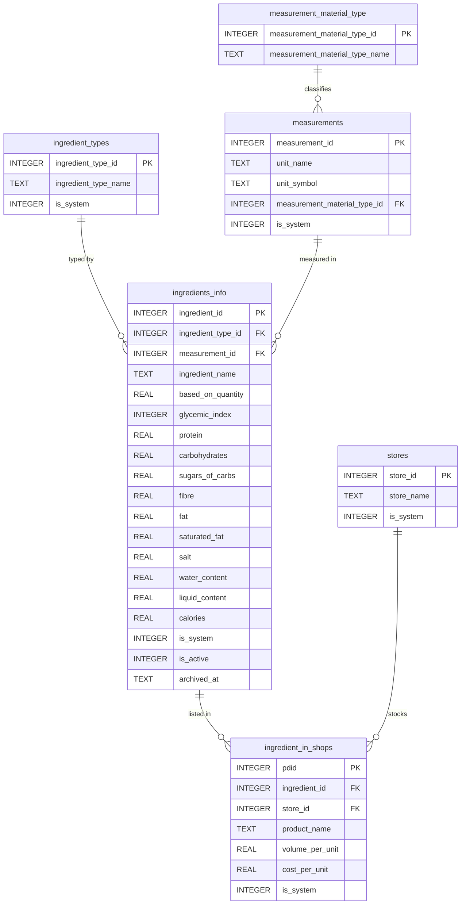

# Gym_App – Database Schema Reference

**Engine:** SQLite  
**Migration tool:** Flyway  
**Migration path:** `src/main/resources/db/migration/sqlite/`  
**Schema version:** V29 (current)

---

## Table of Contents

1. [Architecture Overview](#1-architecture-overview)
2. [Design Pattern – Draft + Versioned Snapshot](#2-design-pattern--draft--versioned-snapshot)
3. [Entity Relationship Diagram](#3-entity-relationship-diagram)
4. [Schema Reference](#4-schema-reference)
   - 4.1 [Identity & Session](#41-identity--session)
   - 4.2 [Reference / Lookup Data](#42-reference--lookup-data)
   - 4.3 [Ingredient Inventory](#43-ingredient-inventory)
   - 4.4 [Plan Layer (Versioned – Immutable)](#44-plan-layer-versioned--immutable)
   - 4.5 [Meal Layer (Versioned – Immutable)](#45-meal-layer-versioned--immutable)
   - 4.6 [Draft Layer (Mutable – Working Copy)](#46-draft-layer-mutable--working-copy)
   - 4.7 [System Tables](#47-system-tables)
5. [Views Catalogue](#5-views-catalogue)
6. [Triggers Catalogue](#6-triggers-catalogue)
7. [Migration History](#7-migration-history)
8. [Seed Data](#8-seed-data)
9. [Invariants & Rules](#9-invariants--rules)
10. [SQL Action Reference](#10-sql-action-reference)
11. [Developer Notes](#11-developer-notes)

---

## 1. Architecture Overview

The schema is organised into three conceptual layers:

| Layer | Purpose | Mutability |
|---|---|---|
| **Reference / Identity** | Users, lookup tables, ingredient catalogue | Partially mutable (see triggers) |
| **Draft** | In-progress working copy of a plan while editing | Fully mutable (INSERT / UPDATE / DELETE) |
| **Versioned** | Immutable historical snapshots created on explicit save | Append-only (INSERT only) |

The application never mixes draft and versioned data. Draft tables hold transient working state; versioned tables hold permanent history.

---

## 2. Design Pattern – Draft + Versioned Snapshot

### How it works

```
User edits plan
        │
        ▼
  [Draft tables]  ← INSERT / UPDATE / DELETE freely
        │
        │  User clicks "Save Plan"
        ▼
  [Version tables] ← INSERT snapshot rows
        │
        │  Draft rows are deleted
        ▼
  New plan_version becomes active
```

### Key properties

- **One active draft per user per plan** — enforced by unique index.
- **Versions are append-only** — enforced by `BEFORE UPDATE` triggers that RAISE ABORT on all version tables.
- **Revert** = pointer swap (`UPDATE active_plans SET plan_version_id = X`). No data is copied.
- **Cancel** = `DELETE FROM draft_*`. No version is created.

### Ownership model

All versioned rows use **single-ownership (owned snapshot)** versioning. Each version row belongs to exactly one parent version row and is never shared or reused. This model prioritises correctness and simplicity over storage deduplication.

---

## 3. Entity Relationship Diagram

### 3.1 Reference & Versioned Side

```mermaid
erDiagram

    users {
        INTEGER user_id PK
        TEXT    user_name
    }

    active_user {
        INT singleton_id PK
        INT user_id      FK
    }

    plans {
        INTEGER plan_id              PK
        INTEGER user_id              FK
        TEXT    plan_name
        INTEGER vegan
        TEXT    date_time_of_creation
    }

    plan_versions {
        INTEGER plan_version_id      PK
        INTEGER plan_id              FK
        INTEGER user_id              FK
        INTEGER version_number
        BLOB    correlation_uuid
        TEXT    date_time_last_edited
    }

    active_plans {
        INTEGER user_id          PK_FK
        INTEGER plan_version_id  FK
    }

    macros_per_pound_and_limits {
        INTEGER macros_id           PK
        INTEGER user_id             FK
        INTEGER plan_version_id     FK
        REAL    current_weight_kg
        REAL    protein_per_pound
        REAL    carbohydrates_per_pound
        REAL    fats_per_pound
        REAL    fibre
        REAL    saturated_fat_limit
        REAL    salt_limit
        REAL    water_target
        REAL    additional_calories
    }

    meals_in_plan {
        INTEGER meal_in_plan_id  PK
        BLOB    correlation_uuid
    }

    meals_in_plan_versions {
        INTEGER meal_in_plan_version_id  PK
        INTEGER meal_in_plan_id          FK
        INTEGER plan_version_id          FK
        TEXT    meal_name
        TEXT    meal_time
        BLOB    correlation_uuid
    }

    divided_meal_sections {
        INTEGER div_meal_sections_id  PK
        BLOB    correlation_uuid
    }

    divided_meal_sections_versions {
        INTEGER div_meal_sections_version_id  PK
        INTEGER div_meal_sections_id          FK
        INTEGER meal_in_plan_version_id       FK
        INTEGER plan_version_id               FK
        TEXT    sub_meal_name
        TEXT    sub_meal_time
        BLOB    correlation_uuid
    }

    ingredients_in_sections_of_meal {
        INTEGER ingredients_index          PK
        INTEGER div_meal_sections_version_id FK
        INTEGER ingredient_id              FK
        INTEGER pdid                       FK
        REAL    quantity
    }

    users ||--o{ plans : "owns"
    users ||--o| active_user : "session"
    plans ||--o{ plan_versions : "versioned as"
    plan_versions ||--o| active_plans : "pointed to by"
    plan_versions ||--o| macros_per_pound_and_limits : "has one"
    plan_versions ||--o{ meals_in_plan_versions : "contains"
    meals_in_plan ||--o{ meals_in_plan_versions : "versioned as"
    meals_in_plan_versions ||--o{ divided_meal_sections_versions : "contains"
    divided_meal_sections ||--o{ divided_meal_sections_versions : "versioned as"
    divided_meal_sections_versions ||--o{ ingredients_in_sections_of_meal : "contains"
```

### 3.2 Draft Side

```mermaid
erDiagram

    draft_plans {
        INTEGER plan_id          PK_FK
        INTEGER plan_version_id  FK
        INTEGER user_id          FK
        TEXT    date_time_last_edited
    }

    draft_macros_per_pound_and_limits {
        INTEGER plan_id          PK_FK
        INTEGER user_id          FK
        REAL    current_weight_kg
        REAL    protein_per_pound
        REAL    carbohydrates_per_pound
        REAL    fats_per_pound
        REAL    fibre
        REAL    saturated_fat_limit
        REAL    salt_limit
        REAL    water_target
        REAL    additional_calories
    }

    draft_meals_in_plan {
        INTEGER draft_meal_in_plan_id  PK
        INTEGER meal_in_plan_id        FK
        INTEGER plan_id                FK
        TEXT    meal_name
        TEXT    meal_time
    }

    draft_divided_meal_sections {
        INTEGER draft_div_meal_sections_id  PK
        INTEGER div_meal_sections_id        FK
        INTEGER draft_meal_in_plan_id       FK
        INTEGER plan_id                     FK
        TEXT    sub_meal_name
        TEXT    sub_meal_time
    }

    draft_ingredients_in_sections_of_meal {
        INTEGER draft_ingredients_index       PK
        INTEGER draft_div_meal_sections_id    FK
        INTEGER ingredient_id                 FK
        INTEGER pdid                          FK
        REAL    quantity
    }

    draft_plans ||--o| draft_macros_per_pound_and_limits : "has one"
    draft_plans ||--o{ draft_meals_in_plan : "contains"
    draft_meals_in_plan ||--o{ draft_divided_meal_sections : "contains"
    draft_divided_meal_sections ||--o{ draft_ingredients_in_sections_of_meal : "contains"
```

### 3.3 Reference / Ingredient Catalogue



---

## 4. Schema Reference

### 4.1 Identity & Session

#### `users`
Application users. The root identity entity.

| Column | Type | Constraints | Description |
|--------|------|-------------|-------------|
| `user_id` | INTEGER | PK, AUTOINCREMENT | Surrogate key |
| `user_name` | TEXT | NOT NULL, `length <= 100`, UNIQUE INDEX | Display name |

**Indexes:**
- `no_repeat_user_names` — UNIQUE on `user_name`

---

#### `active_user`
Singleton table. Tracks the currently active user session.

| Column | Type | Constraints | Description |
|--------|------|-------------|-------------|
| `singleton_id` | INT | PK, CHECK = 1 | Enforces one row maximum |
| `user_id` | INT | NOT NULL, FK → `users` ON DELETE CASCADE | Active user |

> At most one row can exist. The `CHECK (singleton_id = 1)` constraint enforces this at the DB level.

---

### 4.2 Reference / Lookup Data

#### `ingredient_types`
Lookup table for ingredient categories (e.g. Protein, Carbohydrate, Vegetable).

| Column | Type | Constraints | Description |
|--------|------|-------------|-------------|
| `ingredient_type_id` | INTEGER | PK, AUTOINCREMENT | Surrogate key |
| `is_system` | INTEGER | NOT NULL, DEFAULT 0, CHECK IN (0,1) | System rows are immutable |
| `ingredient_type_name` | TEXT | NOT NULL, `length <= 100`, UNIQUE INDEX | Category name |

**System rows (seeded):** `N/A`, `Un-Assigned`

**Triggers:** `is_system` column is immutable post-insert. System rows cannot be deleted.

---

#### `measurement_material_type`
Classifies measurement units by material state (Solids, Liquids, N/A). **Fully immutable after seeding.**

| Column | Type | Constraints | Description |
|--------|------|-------------|-------------|
| `measurement_material_type_id` | INTEGER | PK, AUTOINCREMENT | Surrogate key |
| `measurement_material_type_name` | TEXT | NOT NULL, `length <= 100`, UNIQUE INDEX | Material class name |

**System rows (seeded):** `Solids`, `Liquids`, `N/A`

**Triggers:** INSERT, UPDATE, and DELETE are all blocked. The table is frozen after migration V17.

---

#### `measurements`
Units of measurement. **Fully immutable after seeding.**

| Column | Type | Constraints | Description |
|--------|------|-------------|-------------|
| `measurement_id` | INTEGER | PK, AUTOINCREMENT | Surrogate key |
| `is_system` | INTEGER | NOT NULL, DEFAULT 0, CHECK IN (0,1) | System flag |
| `unit_name` | TEXT | NOT NULL, `length <= 100`, UNIQUE INDEX | Full unit name |
| `unit_symbol` | TEXT | NOT NULL, `length <= 10` | Symbol (e.g. `g`, `L`) |
| `measurement_material_type_id` | INTEGER | NOT NULL, FK → `measurement_material_type` ON DELETE CASCADE | Material class |

**System rows (seeded):** `Grams (g)`, `Litres (L)`, `N/A`

**Triggers:** INSERT, UPDATE, and DELETE are all blocked after migration V17.

---

### 4.3 Ingredient Inventory

#### `ingredients_info`
Master ingredient catalogue. Each row represents a food item with its nutritional profile per `based_on_quantity` of the ingredient's unit.

| Column | Type | Constraints | Description |
|--------|------|-------------|-------------|
| `ingredient_id` | INTEGER | PK, AUTOINCREMENT | Surrogate key |
| `is_system` | INTEGER | NOT NULL, DEFAULT 0, CHECK IN (0,1) | System rows are immutable |
| `is_active` | INTEGER | NOT NULL, DEFAULT 1, CHECK IN (0,1) | Soft-delete flag |
| `archived_at` | TEXT | NULL | Timestamp of archival |
| `measurement_id` | INTEGER | NOT NULL, FK → `measurements` ON DELETE RESTRICT | Unit of measurement |
| `ingredient_type_id` | INTEGER | NOT NULL, FK → `ingredient_types` ON DELETE RESTRICT | Category |
| `ingredient_name` | TEXT | NOT NULL, `length <= 100` | Name |
| `based_on_quantity` | REAL | NOT NULL, `>= 0` | Reference quantity for macro values below |
| `glycemic_index` | INTEGER | NOT NULL, `0 – 100` | GI score |
| `protein` | REAL | NOT NULL | Protein per `based_on_quantity` |
| `carbohydrates` | REAL | NOT NULL | Carbohydrates per `based_on_quantity` |
| `sugars_of_carbs` | REAL | NOT NULL | Sugars (of carbs) per `based_on_quantity` |
| `fibre` | REAL | NOT NULL | Fibre per `based_on_quantity` |
| `fat` | REAL | NOT NULL | Fat per `based_on_quantity` |
| `saturated_fat` | REAL | NOT NULL | Saturated fat per `based_on_quantity` |
| `salt` | REAL | NOT NULL | Salt per `based_on_quantity` |
| `water_content` | REAL | NOT NULL | Water content per `based_on_quantity` |
| `liquid_content` | REAL | NOT NULL | Liquid content per `based_on_quantity` |
| `calories` | REAL | NOT NULL | Calories per `based_on_quantity` |

**Partial unique index:** `no_repeat_active_ingredient_names` — UNIQUE on `lower(trim(ingredient_name))` WHERE `is_active = 1`. Archived ingredients do not block re-use of the name.

**System rows (seeded):** `None Of The Above` (zeroed-out N/A ingredient).

**Triggers:** `is_system` is immutable post-insert. System rows cannot be updated.

> **Macro calculation formula:**  
> `nutrient_for_quantity = (nutrient / based_on_quantity) * actual_quantity`

---

#### `stores`
Retail stores or suppliers.

| Column | Type | Constraints | Description |
|--------|------|-------------|-------------|
| `store_id` | INTEGER | PK, AUTOINCREMENT | Surrogate key |
| `is_system` | INTEGER | NOT NULL, DEFAULT 0, CHECK IN (0,1) | System flag |
| `store_name` | TEXT | NOT NULL, `length <= 100`, UNIQUE INDEX | Store name |

**System rows (seeded):** `No Shop`

**Triggers:** `is_system` immutable. System rows cannot be deleted.

---

#### `ingredient_in_shops`
Links an ingredient to a product listing at a specific store, with pricing.

| Column | Type | Constraints | Description |
|--------|------|-------------|-------------|
| `pdid` | INTEGER | PK, AUTOINCREMENT | Product ID |
| `is_system` | INTEGER | NOT NULL, DEFAULT 0, CHECK IN (0,1) | System flag |
| `ingredient_id` | INTEGER | NOT NULL, FK → `ingredients_info` ON DELETE CASCADE | Base ingredient |
| `store_id` | INTEGER | NOT NULL, FK → `stores` ON DELETE CASCADE | Retailer |
| `product_name` | TEXT | NOT NULL, `length <= 100` | Brand / product label |
| `volume_per_unit` | REAL | NOT NULL, `>= 0` | Package size (use `0` for N/A) |
| `cost_per_unit` | REAL | NOT NULL, `>= 0` | Price per unit |

**Unique index:** `no_repeat_products_in_store` — UNIQUE on `(store_id, product_name)`

**Triggers:** `is_system` and `ingredient_id` are immutable post-insert. System rows cannot be deleted. `product_name`, `volume_per_unit`, `cost_per_unit`, and `store_id` are mutable.

---

### 4.4 Plan Layer (Versioned – Immutable)

#### `plans`
Logical plan entity. Represents a named nutrition plan owned by a user. Plans do not change over time — all editable data lives in `plan_versions`.

| Column | Type | Constraints | Description |
|--------|------|-------------|-------------|
| `plan_id` | INTEGER | PK, AUTOINCREMENT | Surrogate key |
| `date_time_of_creation` | TEXT | NOT NULL, DEFAULT `strftime(...)` | ISO-8601 creation timestamp |
| `user_id` | INTEGER | NOT NULL, FK → `users` ON DELETE CASCADE | Owning user |
| `vegan` | INTEGER | NOT NULL, DEFAULT 0, CHECK IN (0,1) | Vegan flag |
| `plan_name` | TEXT | NOT NULL, `length <= 100` | Display name |

**Unique index:** `unique_plan_name_by_user` — UNIQUE on `(user_id, plan_name)`

**Triggers:** `date_time_of_creation`, `user_id`, and `vegan` are immutable. Only `plan_name` can be updated.

---

#### `plan_versions`
Immutable snapshots of a plan. Created only on explicit user save. **Append-only.**

| Column | Type | Constraints | Description |
|--------|------|-------------|-------------|
| `plan_version_id` | INTEGER | PK, AUTOINCREMENT | Surrogate key |
| `correlation_uuid` | BLOB(16) | NULL | Optional cross-version identity link |
| `plan_id` | INTEGER | NOT NULL, FK → `plans` ON DELETE CASCADE | Parent plan |
| `user_id` | INTEGER | NOT NULL, FK → `users` ON DELETE CASCADE | Owning user |
| `version_number` | INTEGER | NOT NULL, CHECK `> 0` | Monotonically increasing version |
| `date_time_last_edited` | TEXT | NOT NULL, DEFAULT `strftime(...)` | Snapshot timestamp |

**Unique index:** `no_repeated_vs_numbers_per_plan` — UNIQUE on `(plan_id, version_number)`

**Triggers:** Fully immutable — any UPDATE raises ABORT.

---

#### `active_plans`
Pointer table. Tracks which `plan_version` is the currently active version for each user.

| Column | Type | Constraints | Description |
|--------|------|-------------|-------------|
| `user_id` | INTEGER | PK, FK → `users` ON DELETE CASCADE | One row per user |
| `plan_version_id` | INTEGER | NOT NULL, FK → `plan_versions` ON DELETE CASCADE | Currently active version |

**Unique index:** `unique_ownership_per_plan` — UNIQUE on `plan_version_id` (one user per active version).

> Reverting to a previous version = `UPDATE active_plans SET plan_version_id = <old_id> WHERE user_id = ?`

---

#### `macros_per_pound_and_limits`
Versioned macro targets for a plan version. One row per `plan_version_id`. **Append-only.**

| Column | Type | Constraints | Description |
|--------|------|-------------|-------------|
| `macros_id` | INTEGER | PK, AUTOINCREMENT | Surrogate key |
| `user_id` | INTEGER | NOT NULL, FK → `users` ON DELETE CASCADE | Owner |
| `plan_version_id` | INTEGER | NOT NULL, FK → `plan_versions` ON DELETE CASCADE | Parent version (1-to-1) |
| `date_time_of_creation` | TEXT | NOT NULL, DEFAULT `strftime(...)` | Snapshot timestamp |
| `current_weight_kg` | REAL | NOT NULL | Body weight in kg |
| `current_weight_in_pounds` | REAL | NOT NULL | Body weight in pounds |
| `body_fat_percentage` | REAL | NOT NULL | Body fat % |
| `protein_per_pound` | REAL | NOT NULL | Target protein g per lb of bodyweight |
| `carbohydrates_per_pound` | REAL | NOT NULL | Target carbs g per lb |
| `fibre` | REAL | NOT NULL | Absolute fibre target (g) |
| `fats_per_pound` | REAL | NOT NULL | Target fat g per lb |
| `saturated_fat_limit` | REAL | NOT NULL | Max saturated fat (g) |
| `salt_limit` | REAL | NOT NULL | Max salt (g) |
| `water_target` | REAL | NOT NULL | Water intake target (L) |
| `additional_calories` | REAL | NOT NULL | Extra calorie allowance on top of base |

**Unique index:** `unique_macros_per_plan_version` — UNIQUE on `plan_version_id` (1:1 with plan version).

**Triggers:** Fully immutable — any UPDATE raises ABORT.

---

### 4.5 Meal Layer (Versioned – Immutable)

#### `meals_in_plan`
Identity records for meals. Provides a stable identity row that meal versions reference. **Append-only.**

| Column | Type | Constraints | Description |
|--------|------|-------------|-------------|
| `meal_in_plan_id` | INTEGER | PK, AUTOINCREMENT | Stable meal identity key |
| `date_time_of_creation` | TEXT | NOT NULL, DEFAULT `strftime(...)` | Creation timestamp |
| `correlation_uuid` | BLOB(16) | NULL, UNIQUE INDEX | Optional identity link |

**Triggers:** Fully immutable — any UPDATE raises ABORT.

---

#### `meals_in_plan_versions`
Versioned snapshot of a meal within a specific plan version. **Append-only.**

| Column | Type | Constraints | Description |
|--------|------|-------------|-------------|
| `meal_in_plan_version_id` | INTEGER | PK, AUTOINCREMENT | Surrogate key |
| `correlation_uuid` | BLOB(16) | NULL, UNIQUE INDEX | Optional cross-version link |
| `meal_in_plan_id` | INTEGER | NOT NULL, FK → `meals_in_plan` ON DELETE CASCADE | Stable identity |
| `plan_version_id` | INTEGER | NOT NULL, FK → `plan_versions` ON DELETE CASCADE | Owning plan version |
| `date_time_last_edited` | TEXT | NOT NULL, DEFAULT `strftime(...)` | Snapshot timestamp |
| `meal_name` | TEXT | NOT NULL, `length <= 100` | Meal name |
| `meal_time` | TEXT | NOT NULL, GLOB `[0-2][0-9]:[0-5][0-9]*` | ISO time (HH:MM) |

**Unique indexes:**
- `unique_versions_per_plan` — UNIQUE on `(meal_in_plan_id, plan_version_id)` (one meal per plan version)
- `no_repeat_meal_times_in_plan` — UNIQUE on `(plan_version_id, meal_time)`
- `no_repeat_meal_names_in_plan` — UNIQUE on `(plan_version_id, meal_name)`

**Triggers:** Fully immutable — any UPDATE raises ABORT.

---

#### `divided_meal_sections`
Identity records for sub-meals (sections within a meal). **Append-only.**

| Column | Type | Constraints | Description |
|--------|------|-------------|-------------|
| `div_meal_sections_id` | INTEGER | PK, AUTOINCREMENT | Stable sub-meal identity key |
| `date_time_of_creation` | TEXT | NOT NULL, DEFAULT `strftime(...)` | Creation timestamp |
| `correlation_uuid` | BLOB(16) | NULL, UNIQUE INDEX | Optional identity link |

**Triggers:** Fully immutable — any UPDATE raises ABORT.

---

#### `divided_meal_sections_versions`
Versioned snapshot of a sub-meal (section) within a meal version. **Append-only.**

| Column | Type | Constraints | Description |
|--------|------|-------------|-------------|
| `div_meal_sections_version_id` | INTEGER | PK, AUTOINCREMENT | Surrogate key |
| `correlation_uuid` | BLOB(16) | NULL, UNIQUE INDEX | Optional cross-version link |
| `div_meal_sections_id` | INTEGER | NOT NULL, FK → `divided_meal_sections` ON DELETE CASCADE | Stable identity |
| `meal_in_plan_version_id` | INTEGER | NOT NULL, FK → `meals_in_plan_versions` ON DELETE CASCADE | Parent meal version |
| `plan_version_id` | INTEGER | NOT NULL, FK → `plan_versions` ON DELETE CASCADE | Parent plan version |
| `date_time_last_edited` | TEXT | NOT NULL, DEFAULT `strftime(...)` | Snapshot timestamp |
| `sub_meal_name` | TEXT | NULL, `length <= 100` | Section name |
| `sub_meal_time` | TEXT | NULL, GLOB `[0-2][0-9]:[0-5][0-9]*` | ISO time (HH:MM) |

**Unique indexes:**
- `no_repeated_meal_sections_per_plan` — UNIQUE on `(div_meal_sections_id, plan_version_id)`
- `no_repeated_sub_meal_times_per_plan` — UNIQUE on `(plan_version_id, sub_meal_time)`

**Triggers:** Fully immutable — any UPDATE raises ABORT.

---

#### `ingredients_in_sections_of_meal`
Versioned ingredient entries within a sub-meal section. **Append-only.**

| Column | Type | Constraints | Description |
|--------|------|-------------|-------------|
| `ingredients_index` | INTEGER | PK, AUTOINCREMENT | Surrogate key |
| `div_meal_sections_version_id` | INTEGER | NOT NULL, FK → `divided_meal_sections_versions` ON DELETE CASCADE | Parent section version |
| `ingredient_id` | INTEGER | NOT NULL, FK → `ingredients_info` ON DELETE RESTRICT | Ingredient used |
| `pdid` | INTEGER | DEFAULT NULL, FK → `ingredient_in_shops` ON DELETE RESTRICT | Optional product/shop link |
| `quantity` | REAL | NOT NULL, `>= 0` | Quantity in the ingredient's base unit |

> `ON DELETE RESTRICT` on `ingredient_id` means an ingredient cannot be deleted while referenced in a versioned plan. The application must substitute the ingredient first.

**Triggers:** Fully immutable — any UPDATE raises ABORT.

---

### 4.6 Draft Layer (Mutable – Working Copy)

All draft tables are mutable (INSERT / UPDATE / DELETE freely allowed). They are cleared when a plan is saved (committed) or cancelled. Draft data is **never** referenced by versioned tables.

---

#### `draft_plans`
One row per active plan being edited. Uses `plan_id` as PK (one draft per plan).

| Column | Type | Constraints | Description |
|--------|------|-------------|-------------|
| `plan_id` | INTEGER | PK, FK → `plans` ON DELETE CASCADE | Enforces one draft per plan |
| `plan_version_id` | INTEGER | NULL, FK → `plan_versions` ON DELETE CASCADE | Base version being edited (NULL for new plans) |
| `user_id` | INTEGER | NOT NULL, FK → `users` ON DELETE CASCADE | Editing user |
| `date_time_last_edited` | TEXT | NOT NULL, DEFAULT `strftime(...)` | Auto-updated by triggers |

**Unique indexes:** `one_draft_per_user_for_active_plan` — UNIQUE on `user_id`; `one_draft_per_plan_version` — UNIQUE on `plan_version_id`.

**Immutable columns (trigger-protected):** `user_id`  
**Mutable:** `date_time_last_edited`, `plan_version_id`

---

#### `draft_macros_per_pound_and_limits`
Working copy of macro targets. One row per draft plan.

| Column | Type | Constraints | Description |
|--------|------|-------------|-------------|
| `plan_id` | INTEGER | PK, FK → `draft_plans` ON DELETE CASCADE | One macro row per draft plan |
| `user_id` | INTEGER | NOT NULL, FK → `users` ON DELETE CASCADE | Owner |
| *(macro columns)* | REAL | NOT NULL | Same columns as `macros_per_pound_and_limits` |

**Immutable columns (trigger-protected):** `user_id`

---

#### `draft_meals_in_plan`
Working copy of meals within the draft plan.

| Column | Type | Constraints | Description |
|--------|------|-------------|-------------|
| `draft_meal_in_plan_id` | INTEGER | PK, AUTOINCREMENT | Surrogate key |
| `meal_in_plan_id` | INTEGER | NULL, FK → `meals_in_plan` ON DELETE CASCADE | Links to versioned identity (NULL for new meals) |
| `plan_id` | INTEGER | NOT NULL, FK → `draft_plans` ON DELETE CASCADE | Parent draft plan |
| `date_time_last_edited` | TEXT | NOT NULL, DEFAULT `strftime(...)` | Auto-updated by triggers |
| `meal_name` | TEXT | NOT NULL, `length <= 100` | Meal name |
| `meal_time` | TEXT | NOT NULL, GLOB `[0-2][0-9]:[0-5][0-9]*` | ISO time (HH:MM) |

**Unique indexes:**
- `no_repeat_draft_meal_times_in_plan` — UNIQUE on `(plan_id, meal_time)`
- `no_repeat_draft_meal_names_in_plan` — UNIQUE on `(plan_id, meal_name)`
- `one_draft_row_per_versioned_meal` — partial UNIQUE on `meal_in_plan_id` WHERE NOT NULL

**Immutable columns (trigger-protected):** `plan_id`  
**Triggers:** INSERT / UPDATE / DELETE on this table propagate timestamp updates to `draft_plans`.

---

#### `draft_divided_meal_sections`
Working copy of sub-meal sections within a draft meal.

| Column | Type | Constraints | Description |
|--------|------|-------------|-------------|
| `draft_div_meal_sections_id` | INTEGER | PK | Surrogate key |
| `div_meal_sections_id` | INTEGER | NULL, FK → `divided_meal_sections` ON DELETE CASCADE | Links to versioned identity (NULL for new sections) |
| `draft_meal_in_plan_id` | INTEGER | NOT NULL, FK → `draft_meals_in_plan` ON DELETE CASCADE | Parent draft meal |
| `plan_id` | INTEGER | NOT NULL, FK → `draft_plans` ON DELETE CASCADE | Parent draft plan |
| `date_time_last_edited` | TEXT | NOT NULL, DEFAULT `strftime(...)` | Auto-updated by triggers |
| `sub_meal_name` | TEXT | NOT NULL, `length <= 100` | Section name |
| `sub_meal_time` | TEXT | NOT NULL, GLOB `[0-2][0-9]:[0-5][0-9]*` | ISO time (HH:MM) |

**Unique indexes:**
- `no_repeated_draft_meal_sections_vs_per_plan` — UNIQUE on `(plan_id, div_meal_sections_id)`
- `no_repeated_draft_sub_meal_times_per_plan` — UNIQUE on `(plan_id, sub_meal_time)`
- `one_draft_row_per_versioned_sub_meal` — partial UNIQUE on `div_meal_sections_id` WHERE NOT NULL

**Immutable columns (trigger-protected):** `draft_meal_in_plan_id`, `plan_id`  
**Triggers:** INSERT / UPDATE / DELETE propagate timestamp updates to `draft_meals_in_plan`.

---

#### `draft_ingredients_in_sections_of_meal`
Working copy of ingredient entries within a draft sub-meal section.

| Column | Type | Constraints | Description |
|--------|------|-------------|-------------|
| `draft_ingredients_index` | INTEGER | PK | Surrogate key |
| `draft_div_meal_sections_id` | INTEGER | NOT NULL, FK → `draft_divided_meal_sections` ON DELETE CASCADE | Parent section |
| `ingredient_id` | INTEGER | NOT NULL, FK → `ingredients_info` ON DELETE CASCADE | Ingredient used |
| `pdid` | INTEGER | NULL, FK → `ingredient_in_shops` ON DELETE RESTRICT | Optional product link |
| `quantity` | REAL | NOT NULL, `>= 0` | Amount in the ingredient's base unit |

**Immutable columns (trigger-protected):** `draft_div_meal_sections_id`  
**Mutable:** `ingredient_id`, `quantity`, `pdid`  
**Triggers:** INSERT / UPDATE / DELETE propagate timestamp updates to `draft_divided_meal_sections`.

---

### 4.7 System Tables

#### `seed_registry`
Lookup table that stores the stable IDs of seeded system rows. Used internally by seed migrations so subsequent migrations can reference system entities by a named key rather than a hardcoded integer.

| Column | Type | Constraints | Description |
|--------|------|-------------|-------------|
| `seed_key` | TEXT | PK, `length <= 100` | Logical name for the system entity |
| `entity_table_name` | TEXT | NOT NULL, `length <= 100` | Source table name |
| `entity_id_value` | INT | NOT NULL | PK value of the seeded row |

**Unique index:** `unique_id_per_table` — UNIQUE on `(entity_table_name, entity_id_value)`

**Known seed keys:**

| seed_key | entity_table_name | Description |
|----------|-------------------|-------------|
| `na_type_id` | ingredient_types | "N/A" ingredient type |
| `na_material_type_id` | measurement_material_type | "N/A" material type |
| `solids_material_type_id` | measurement_material_type | "Solids" |
| `liquids_material_type_id` | measurement_material_type | "Liquids" |
| `na_measurement_id` | measurements | "N/A" unit |
| `grams_measurement_id` | measurements | "Grams" unit |
| `litres_measurement_id` | measurements | "Litres" unit |
| `na_store_id` | stores | "No Shop" store |
| `na_ingredient_id` | ingredients_info | "None Of The Above" ingredient |

---

## 5. Views Catalogue

All views are created in migration `V26__create_views.sql`.

Views follow a consistent naming pattern: `{scope}_{subject}` where scope is `all_`, `draft_`, `draft_gui_`, or `versioned_`.

### 5.1 Macro Target Calculations

| View | Description |
|------|-------------|
| `all_plan_macro_target_calculations` | Base CTE view. Unions draft + versioned macro rows. Calculates `t_protein`, `t_carbs`, `t_fats`, `calories_target`, and `additional_calories_target` from per-pound targets × bodyweight. |
| `draft_plan_macro_target_calculations` | Filters `all_plan_macro_target_calculations` to draft state. |
| `draft_gui_plan_macro_target_calculations` | Draft macro targets without `date_time_of_creation` (for GUI display). |
| `versioned_plan_macro_target_calculations` | Filters to versioned state. |

**Calculation logic:**
```
t_protein = ROUND(current_weight_in_pounds × protein_per_pound, 2)
t_carbs   = ROUND(current_weight_in_pounds × carbohydrates_per_pound, 2)
t_fats    = ROUND(current_weight_in_pounds × fats_per_pound, 2)
calories_target = ROUND((t_protein × 4) + (t_carbs × 4) + (t_fats × 9), 2)
additional_calories_target = calories_target + additional_calories
```

---

### 5.2 Ingredient Macro Calculations

| View | Description |
|------|-------------|
| `all_ingredients_in_sections_of_meal_calculation` | Unions draft + versioned ingredient rows. Calculates pro-rated macros per actual `quantity` using the `based_on_quantity` ratio from `ingredients_info`. Returns `gi`, `protein`, `carbohydrates`, `sugars_of_carbs`, `fibre`, `fat`, `saturated_fat`, `salt`, `water_content`, `calories`. |
| `versioned_ingredients_in_sections_of_meal_calculation` | Versioned rows only. |
| `draft_ingredients_in_sections_of_meal_calculation` | Draft rows only. |
| `draft_gui_ingredients_in_sections_of_meal_calculation` | Draft rows, formatted for GUI table (includes `delete_button` placeholder column). |

**Calculation logic (per ingredient):**
```
nutrient = IFNULL(ROUND((info.nutrient / info.based_on_quantity) × quantity, 2), 0)
```

---

### 5.3 Sub-Meal (Section) Aggregations

| View | Description |
|------|-------------|
| `all_divided_meal_sections_calculations` | Groups `all_ingredients_in_sections_of_meal_calculation` by `(record_state, div_id)`. Sums all macro columns per sub-meal section. |
| `versioned_divided_meal_sections_calculations` | Versioned sub-meal totals. |
| `draft_divided_meal_sections_calculations` | Draft sub-meal totals. |

---

### 5.4 Total Meal Aggregations

| View | Description |
|------|-------------|
| `all_total_meal_view` | Aggregates sub-meal totals up to meal level. Joins meal metadata (name, time), ingredient count, and summed macros per meal. Unions draft + versioned. |
| `versioned_total_meal_view` | Versioned meal totals. |
| `draft_total_meal_view` | Draft meal totals. |
| `draft_gui_total_meal_view` | Draft meal totals without `plan_id` (for GUI table). |

---

### 5.5 Total Plan Aggregations

| View | Description |
|------|-------------|
| `all_total_plan_view` | Aggregates meal totals up to plan level. Includes `no_of_meals`, all macro sums, and `total_calories_in_plan`. Unions draft + versioned. |
| `versioned_total_plan_view` | Versioned plan totals. |
| `draft_total_plan_view` | Draft plan totals. |

---

### 5.6 Macros Remaining

| View | Description |
|------|-------------|
| `all_plan_macros_left` | Subtracts actual plan totals (`all_total_plan_view`) from macro targets (`all_plan_macro_target_calculations`). Returns remaining budget per macro. |
| `versioned_plan_macros_left` | Versioned macro budget remaining. |
| `draft_plan_macros_left` | Draft macro budget remaining. |
| `draft_gui_plan_macros_left` | Draft remaining budget without `plan_name` (for GUI). |

---

### 5.7 Progress

| View | Description |
|------|-------------|
| `draft_plan_macros_progress` | Calculates percentage completion toward each macro target: `protein_progress`, `carbs_progress`, `fats_progress`, `cal_progress`. |

---

## 6. Triggers Catalogue

Triggers are created in migrations V27 (reference), V28 (draft), and V29 (versioned).

### 6.1 Reference Data Triggers (`V27`)

| Trigger | Table | Event | Action |
|---------|-------|-------|--------|
| `prevent_ingredient_types_delete_on_is_systems` | `ingredient_types` | BEFORE DELETE WHERE `is_system = 1` | RAISE ABORT |
| `trg_ingredient_types_allow_only_safe_updates` | `ingredient_types` | BEFORE UPDATE OF `is_system` | RAISE ABORT |
| `prevent_delete_on_measurement_material_type` | `measurement_material_type` | BEFORE DELETE | RAISE ABORT |
| `trg_measurement_material_type_prevent_any_update` | `measurement_material_type` | BEFORE UPDATE | RAISE ABORT |
| `prevent_insert_on_measurement_material_type` | `measurement_material_type` | BEFORE INSERT | RAISE ABORT |
| `prevent_delete_on_measurements` | `measurements` | BEFORE DELETE | RAISE ABORT |
| `trg_measurements_prevent_any_update` | `measurements` | BEFORE UPDATE | RAISE ABORT |
| `prevent_insert_on_measurements` | `measurements` | BEFORE INSERT | RAISE ABORT |
| `prevent_update_on_ingredients_info_system_rows_immutable` | `ingredients_info` | BEFORE UPDATE WHERE `is_system = 1` | RAISE ABORT |
| `trg_ingredients_info_allow_only_safe_updates` | `ingredients_info` | BEFORE UPDATE OF `is_system` | RAISE ABORT |
| `prevent_is_system_delete_on_stores` | `stores` | BEFORE DELETE WHERE `is_system = 1` | RAISE ABORT |
| `trg_stores_allow_only_safe_updates` | `stores` | BEFORE UPDATE OF `is_system` | RAISE ABORT |
| `prevent_is_system_delete_on_ingredient_in_shops` | `ingredient_in_shops` | BEFORE DELETE WHERE `is_system = 1` | RAISE ABORT |
| `trg_ingredient_in_shops_allow_only_safe_updates` | `ingredient_in_shops` | BEFORE UPDATE OF `ingredient_id, is_system` | RAISE ABORT |

---

### 6.2 Draft Triggers (`V28`)

#### Immutability triggers

| Trigger | Table | Protected column(s) |
|---------|-------|---------------------|
| `trg_draft_plans_allow_only_safe_updates` | `draft_plans` | `user_id` |
| `trg_draft_macros_per_pound_and_limits_allow_only_safe_updates` | `draft_macros_per_pound_and_limits` | `user_id` |
| `trg_draft_meals_in_plan_allow_only_safe_updates` | `draft_meals_in_plan` | `plan_id` |
| `trg_draft_divided_meal_sections_allow_only_safe_updates` | `draft_divided_meal_sections` | `draft_meal_in_plan_id`, `plan_id` |
| `trg_ingredients_in_meal_versions_allow_only_safe_updates` | `draft_ingredients_in_sections_of_meal` | `draft_div_meal_sections_id` |

#### Timestamp cascade triggers

These triggers keep `date_time_last_edited` accurate up the ownership chain.

| Trigger | Fire event | Effect |
|---------|-----------|--------|
| `trg_on_draft_meals_update_then_update_plans_date` | AFTER UPDATE on `draft_meals_in_plan` | Updates `draft_plans.date_time_last_edited` |
| `trg_on_draft_meals_insert_then_update_plans_date` | AFTER INSERT on `draft_meals_in_plan` | Updates `draft_plans.date_time_last_edited` |
| `trg_on_draft_meals_delete_then_update_plans_date` | AFTER DELETE on `draft_meals_in_plan` | Updates `draft_plans.date_time_last_edited` |
| `trg_on_draft_sub_meals_update_then_update_meals_date` | AFTER UPDATE on `draft_divided_meal_sections` | Updates `draft_meals_in_plan.date_time_last_edited` |
| `trg_on_draft_sub_meals_insert_then_update_meals_date` | AFTER INSERT on `draft_divided_meal_sections` | Updates `draft_meals_in_plan.date_time_last_edited` |
| `trg_on_draft_sub_meals_delete_then_update_meals_date` | AFTER DELETE on `draft_divided_meal_sections` | Updates `draft_meals_in_plan.date_time_last_edited` |
| `trg_on_draft_ingredients_update_then_update_sub_meals_date` | AFTER UPDATE on `draft_ingredients_in_sections_of_meal` | Updates `draft_divided_meal_sections.date_time_last_edited` |
| `trg_on_draft_ingredients_insert_then_update_sub_meals_date` | AFTER INSERT on `draft_ingredients_in_sections_of_meal` | Updates `draft_divided_meal_sections.date_time_last_edited` |
| `trg_on_draft_ingredients_delete_then_update_sub_meals_date` | AFTER DELETE on `draft_ingredients_in_sections_of_meal` | Updates `draft_divided_meal_sections.date_time_last_edited` |

---

### 6.3 Versioned Triggers (`V29`)

All versioned tables are append-only. These triggers enforce that invariant.

| Trigger | Table | Protection |
|---------|-------|-----------|
| `trg_plans_allow_only_safe_updates` | `plans` | Blocks UPDATE on `date_time_of_creation`, `user_id`, `vegan` |
| `trg_draft_plans_versions_prevent_any_update` | `plan_versions` | Blocks all UPDATEs |
| `trg_macros_per_pound_and_limits_prevent_any_update` | `macros_per_pound_and_limits` | Blocks all UPDATEs |
| `trg_meals_in_plan_prevent_any_update` | `meals_in_plan` | Blocks all UPDATEs |
| `trg_meals_in_plan_versions_prevent_any_update` | `meals_in_plan_versions` | Blocks all UPDATEs |
| `trg_divided_meal_sections_prevent_any_update` | `divided_meal_sections` | Blocks all UPDATEs |
| `trg_divided_meal_sections_versions_prevent_any_update` | `divided_meal_sections_versions` | Blocks all UPDATEs |
| `trg_ingredients_in_sections_of_meal_prevent_any_update` | `ingredients_in_sections_of_meal` | Blocks all UPDATEs |

---

## 7. Migration History

Migrations are managed by Flyway. Files follow the convention `V{N}__{description}.sql`.

**Rules:**
- Migrations are append-only — never edit or delete an applied migration.
- No `DROP DATABASE` or destructive DDL on existing tables.
- Each `V{N}__` file represents exactly one schema version.

| Version | File | Type | Description |
|---------|------|------|-------------|
| V1 | `V1__users.sql` | DDL | `users` table |
| V2 | `V2__active_user.sql` | DDL | `active_user` singleton table |
| V3 | `V3__plans_and_versions.sql` | DDL | `plans` + `plan_versions` tables |
| V4 | `V4__active_plans.sql` | DDL | `active_plans` pointer table |
| V5 | `V5__macros.sql` | DDL | `macros_per_pound_and_limits` (versioned) |
| V6 | `V6__reference_food_dimensions.sql` | DDL | `ingredient_types`, `measurement_material_type`, `measurements` |
| V7 | `V7__ingredients_and_store_inventory.sql` | DDL | `ingredients_info`, `stores`, `ingredient_in_shops` |
| V8 | `V8__meals_and_versions.sql` | DDL | `meals_in_plan` + `meals_in_plan_versions` |
| V9 | `V9__meal_sections.sql` | DDL | `divided_meal_sections` + `divided_meal_sections_versions` |
| V10 | `V10__meal_section_ingredients.sql` | DDL | `ingredients_in_sections_of_meal` (versioned) |
| V11 | `V11__draft_plans.sql` | DDL | `draft_plans` |
| V12 | `V12__draft_macros.sql` | DDL | `draft_macros_per_pound_and_limits` |
| V13 | `V13__draft_meals.sql` | DDL | `draft_meals_in_plan` |
| V14 | `V14__draft_meal_sections.sql` | DDL | `draft_divided_meal_sections` |
| V15 | `V15__draft_meal_section_ingredients.sql` | DDL | `draft_ingredients_in_sections_of_meal` |
| V16 | `V16__seed_registry.sql` | DDL | `seed_registry` system table |
| V17 | `V17__seed_reference_data.sql` | SEED | System reference data: types, measurements, stores, N/A ingredient |
| V18 | `V18__seed_ingredient_types_demo_data.sql` | SEED | Demo ingredient type categories |
| V19 | `V19__seed_ingredients_demo_data.sql` | SEED | Demo ingredient nutritional data |
| V20 | `V20__seed_users_demo_data.sql` | SEED | Demo user records |
| V21 | `V21__seed_plans_and_versions_demo_data.sql` | SEED | Demo plans and versions |
| V22 | `V22__seed_macros_versions_demo_data.sql` | SEED | Demo macro targets |
| V23 | `V23__seed_meals_demo_data.sql` | SEED | Demo meal records |
| V24 | `V24__seed_meal_sections_demo_data.sql` | SEED | Demo sub-meal sections |
| V25 | `V25__seed_meal_section_ingredients_demo_data.sql` | SEED | Demo ingredient entries in sections |
| V26 | `V26__create_views.sql` | DDL | All analytical views |
| V27 | `V27__reference_data_triggers.sql` | DDL | Immutability triggers on reference tables |
| V28 | `V28__draft_triggers.sql` | DDL | Immutability + timestamp cascade triggers on draft tables |
| V29 | `V29__versioned_triggers.sql` | DDL | Immutability triggers on all versioned tables |

> **Note:** V7 is ordered after V6 in file content but Flyway resolves migration order numerically, so V7 always runs after V6 as expected.

---

## 8. Seed Data

System seed data is applied in migration V17. It is idempotent — all inserts use `ON CONFLICT ... DO UPDATE` so re-running is safe.

### System entities seeded by V17

| Table | Value | seed_key | Notes |
|-------|-------|----------|-------|
| `ingredient_types` | `N/A` | `na_type_id` | For unclassified ingredients |
| `ingredient_types` | `Un-Assigned` | — | Default for user-created ingredients |
| `measurement_material_type` | `Solids` | `solids_material_type_id` | |
| `measurement_material_type` | `Liquids` | `liquids_material_type_id` | |
| `measurement_material_type` | `N/A` | `na_material_type_id` | |
| `measurements` | `Grams (g)` | `grams_measurement_id` | `is_system = 1` |
| `measurements` | `Litres (L)` | `litres_measurement_id` | `is_system = 1` |
| `measurements` | `N/A` | `na_measurement_id` | `is_system = 1` |
| `stores` | `No Shop` | `na_store_id` | Placeholder when no retailer is assigned |
| `ingredients_info` | `None Of The Above` | `na_ingredient_id` | Zero-value placeholder ingredient; `is_system = 1` |
| `ingredient_in_shops` | `N/A` in `No Shop` | — | Zero-cost, zero-volume placeholder product |

> Demo data (V18–V25) is for development and testing only. It should not be present in production deployments.

---

## 9. Invariants & Rules

These constraints must never be violated. The schema enforces most of them at the database level; the rest are application-level responsibilities.

| # | Invariant | Enforcement |
|---|-----------|-------------|
| 1 | Draft tables are mutable; version tables are append-only | BEFORE UPDATE triggers RAISE ABORT on all versioned tables |
| 2 | Draft rows are never referenced by versioned rows | Design constraint — no FK from versioned tables into draft tables |
| 3 | Only one active draft exists per user per plan | UNIQUE index on `draft_plans(user_id)` |
| 4 | Only one draft macro row exists per draft plan | UNIQUE index on `draft_macros_per_pound_and_limits(user_id)` |
| 5 | Only one meal per time slot per plan (draft and versioned) | UNIQUE index on `(plan_id, meal_time)` / `(plan_version_id, meal_time)` |
| 6 | A meal can appear only once per plan version | UNIQUE index on `(meal_in_plan_id, plan_version_id)` |
| 7 | A sub-meal section can appear only once per plan version | UNIQUE index on `(div_meal_sections_id, plan_version_id)` |
| 8 | `macros_per_pound_and_limits` is 1:1 with `plan_versions` | UNIQUE index on `plan_version_id` |
| 9 | System rows (`is_system = 1`) are never deleted or mutated | BEFORE DELETE / UPDATE triggers |
| 10 | `measurement_material_type` and `measurements` are fully frozen | INSERT / UPDATE / DELETE all blocked via triggers |
| 11 | An ingredient cannot be deleted while referenced in a versioned plan | `ON DELETE RESTRICT` on `ingredients_in_sections_of_meal.ingredient_id` |
| 12 | `version_number` in `plan_versions` must be > 0 and unique per plan | CHECK + UNIQUE index |
| 13 | Meal times stored as ISO text `HH:MM` (no SQLite TIME type) | GLOB CHECK on all `meal_time` / `sub_meal_time` columns |

---

## 10. SQL Action Reference

| User Action | Tables Written | Tables Cleared | History Created? |
|-------------|---------------|----------------|-----------------|
| Start editing a plan | INSERT into `draft_plans`, `draft_macros_per_pound_and_limits` | — | No |
| Add / edit meal | INSERT / UPDATE `draft_meals_in_plan` | — | No |
| Add / edit sub-meal | INSERT / UPDATE `draft_divided_meal_sections` | — | No |
| Add / update ingredient in section | INSERT / UPDATE `draft_ingredients_in_sections_of_meal` | — | No |
| **Save (Commit) Plan** | INSERT into `plan_versions`, `macros_per_pound_and_limits`, `meals_in_plan_versions`, `divided_meal_sections_versions`, `ingredients_in_sections_of_meal`; UPDATE `active_plans` | DELETE FROM all `draft_*` tables | **Yes — creates new version** |
| Cancel editing | — | DELETE FROM all `draft_*` tables | No |
| Revert to version X | UPDATE `active_plans SET plan_version_id = X` | — | No |
| Delete plan | DELETE FROM `plans` (cascades to all plan_versions and draft) | — | Deletes all history |

---

## 11. Developer Notes

### Adding a new migration

1. Create `V{N+1}__{description}.sql` in `src/main/resources/db/migration/sqlite/`.
2. Never edit an existing applied migration — Flyway will reject it (checksum mismatch).
3. Never use `DROP DATABASE` or destructive DDL on populated tables.
4. If adding a new system reference row, register it in `seed_registry` using `ON CONFLICT ... DO UPDATE` for idempotency.

### Macro calculation pattern

All macro calculations are done in SQL views, not in the application layer. The views use the formula:

```sql
IFNULL(ROUND((info.nutrient / info.based_on_quantity) * quantity, 2), 0)
```

Reads for UI should query the appropriate `draft_*` or `versioned_*` view rather than joining tables manually.

### Draft lifecycle (application responsibility)

The DB enforces one draft per user per plan, but the application is responsible for:
- Creating the draft on "Edit Plan" entry.
- Deleting it on "Cancel".
- Committing it (snapshot + delete) on "Save Plan".
- Ensuring a draft meal linked to a versioned meal belongs to the same plan as that meal's plan version (cross-table consistency not enforceable purely by FK).

### `correlation_uuid` columns

`correlation_uuid` (BLOB 16) is an optional cross-version identity field. It allows the application to correlate an entity across multiple plan versions (e.g. "this meal appeared in v1, v2, and v4"). It is nullable and not required for core functionality.

### SQLite limitations accounted for in schema

| Limitation | How handled |
|------------|-------------|
| No TIME type | `meal_time` / `sub_meal_time` stored as `TEXT` with GLOB format check `[0-2][0-9]:[0-5][0-9]*` |
| FK declarations must be at table end | All FK constraints defined as table-level, not inline |
| Partial UNIQUE indexes | Used where needed (`WHERE is_active = 1`, `WHERE col IS NOT NULL`) — supported in SQLite |
| Integer PKs | `INTEGER PRIMARY KEY AUTOINCREMENT` used where monotonic guarantees are needed |